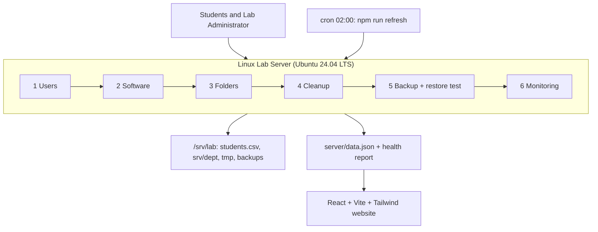
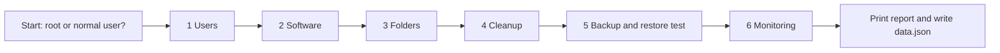

# College Computer Laboratory Server Management (LabServer)

**Linux System Administration (E1ITA307) – Linux Infrastructure Deployment Project**
Alliance School of Advanced Computing, Alliance University, Bengaluru – Nov 2026

LabServer automates the day-to-day administration of a college computer laboratory server: 100 student accounts in four departments, protected shared folders, software checks, temporary-file cleanup, backup with a restore test, and a health report. A React website shows the saved results on a dashboard.

- Website: runs on **macOS, Linux and Windows**.
- Server script (`server/collect.sh`): **Linux only**. It creates real users and groups, so run it inside a Linux machine or virtual machine.

---

### 📄 Project Documents

| Document | Link |
|----------|------|
| 📘 Project Report | [Project-Report.pdf](./ServerCats.pdf) |
| 🎞️ Project Presentation (PDF) | [Project-Presentation.pdf](./Project-Presentation.pdf) |
| 🎨 Project Presentation (Canva) | [View on Canva](https://canva.link/m0wcjxq7cf8hn4h) |

---


## Table of Contents

1. [Project Title and Team](#1-project-title-and-team)
2. [Problem Statement](#2-problem-statement)
3. [Objectives](#3-objectives)
4. [Proposed Solution and Project Overview](#4-proposed-solution-and-project-overview)
5. [System Architecture / Workflow Diagram](#5-system-architecture--workflow-diagram)
6. [Tools, Technologies and Linux Environment Used](#6-tools-technologies-and-linux-environment-used)
7. [Linux Commands, Configurations and Scripts Implemented](#7-linux-commands-configurations-and-scripts-implemented)
8. [Storage Management / LVM / Backup and Recovery](#8-storage-management--lvm--backup-and-recovery)
9. [Automation and Shell Scripting](#9-automation-and-shell-scripting)
10. [Security and User/Permission Management](#10-security-and-userpermission-management)
11. [Implementation Screenshots and Live Demonstration](#11-implementation-screenshots-and-live-demonstration)
12. [Testing, Results and Observations](#12-testing-results-and-observations)
13. [Challenges Faced and Solutions](#13-challenges-faced-and-solutions)
14. [Conclusion and Future Enhancements](#14-conclusion-and-future-enhancements)
15. [References](#15-references)
16. [Appendix A: Project Structure](#appendix-a-project-structure)
17. [Appendix B: data.json Reference](#appendix-b-datajson-reference)
18. [Appendix C: Command Cheat Sheet](#appendix-c-command-cheat-sheet)
19. [Appendix D: Troubleshooting](#appendix-d-troubleshooting)

---

## 1. Project Title and Team

| Item | Detail |
| --- | --- |
| Project title | College Computer Laboratory Server Management (LabServer) |
| Course | Linux System Administration (E1ITA307) |
| Degree | Bachelor of Technology in Information Technology |
| School / University | Alliance School of Advanced Computing, Alliance University, Bengaluru |
| Supervisor | Mrs. Kusuma J. |
| Date | Nov 2026 |
| Repository | https://github.com/allenasat044-prog/labserver |

| Member | Register No. | Role |
| --- | --- | --- |
| Shashank Patel | 2411021061117 | Linux System Administrator |
| Pankaj Pandurang Tike | 2411021061162 | Storage & Backup Administrator |
| Anmol Poddar | 2411021061144 | Automation & Security Engineer |
| Shikhar Srivastava | 2411021061140 | Testing, Documentation & Presentation Lead |

---

## 2. Problem Statement

A college computer laboratory is a shared Linux environment used by many students from several departments. The administrator has to:

- create and organise many student accounts,
- give every department its own private working area,
- keep a standard set of software available,
- remove temporary files that fill the disk,
- take backups and be sure they can be restored,
- and keep an eye on CPU, memory and disk.

Doing this by hand is slow, error-prone and hard to audit. A wrong permission lets one department read another's work, and a backup that was never tested may fail on the day it is needed. The administrator needs a repeatable, automated way to set up and maintain the lab server, and one place to see its current state.

---

## 3. Objectives

1. Create 100 student accounts (25 per department: CSE, ECE, MECH, CIVIL) automatically from a CSV list, with a forced password change at first login.
2. Give each department a shared folder that only its own members can open, using group ownership and the setgid bit (mode `2770`).
3. Verify that the standard lab software (gcc, Python 3, Java, Git, Node.js, make, vim, curl) is installed and report each version.
4. Delete temporary files older than seven days and report how many files and how much space were recovered.
5. Back up the department folders to a compressed archive and prove with a restore test that the backup works.
6. Monitor CPU, memory, disk, load, uptime and logged-in users, and print a health report.
7. Schedule the whole routine with cron and show the results on a web dashboard.

---

## 4. Proposed Solution and Project Overview

The solution has two parts that share one data file.

| Part | What it is | Runs on |
| --- | --- | --- |
| **Administration script** `server/collect.sh` (Bash) with an equivalent `server/collect.py` (Python) | Does the real work and writes `data.json` plus a text report | Linux, as root |
| **Website** (React + Vite + Tailwind) | Reads the saved `data.json` and shows it on six pages | macOS, Linux, Windows |

### What one run of `collect.sh` does

| Step | Module | Result |
| --- | --- | --- |
| 1 | Users | Writes `students.csv`; creates groups `lab-cse`, `lab-ece`, `lab-mech`, `lab-civil` and users `student001` to `student100` |
| 2 | Software | Checks 8 tools with `command -v` and records versions |
| 3 | Folders | Creates `/srv/lab/srv/<dept>`, group-owned, mode `2770`, with `members.txt` |
| 4 | Cleanup | Creates 30 test temp files (20 aged 10 days), deletes files older than 7 days |
| 5 | Backup | Creates `backup-YYYYMMDD-HHMMSS.tar.gz`, extracts it to a temp folder and compares file counts |
| 6 | Monitoring | Reads CPU, memory, disk, load, uptime and logged-in users |
| 7 | Output | Prints the health report and writes `data.json` |

### Website pages

| Page | Shows |
| --- | --- |
| Home | Landing page and project introduction |
| Dashboard | CPU, memory, disk and logged-in-user cards, a comparison chart, the cleanup donut and the terminal report with a **Download .txt** button |
| Backup & Maintenance | Latest backup (file, size, checksum, restore result), automatic cleanup and backup history |
| Storage & Access | The four department folders with path, mode, group and members |
| Users & Software | Number of student accounts and installed software with versions |
| FAQ | How to use the site, with a link to the GitHub repository |

### Scope

The script does the administration; the website is a read-only display of the last saved run and cannot change the server. Not included: central login (LDAP), disk quotas, off-site backup, e-mail alerts. See [Section 14](#14-conclusion-and-future-enhancements).

---

## 5. System Architecture / Workflow Diagram

### 5.1 Architecture



The same picture as plain text, for viewers that do not render Mermaid:

```text
Students / Admin
      |
      v
+--------------------------------------------------------------+
| LINUX LAB SERVER (Ubuntu 24.04)   server/collect.sh (root)   |
| 1 Users | 2 Software | 3 Folders | 4 Cleanup | 5 Backup | 6 Monitor |
+--------------------------------------------------------------+
      |                                   |
      v                                   v
/srv/lab (plain files)            server/data.json + report
 students.csv, srv/<dept>,                |
 tmp, backups                             v
                                  React website (6 pages)
```

### 5.2 Workflow of one run



### 5.3 Data flow

1. `collect.sh` runs on the Linux server (by hand or from cron).
2. It writes `server/data.json`.
3. `npm run refresh` copies it to `src/data.json`, which the website imports.
4. If the website runs on a different computer, copy `data.json` over with `scp` (see [Section 6.4](#64-copy-the-data-between-the-vm-and-your-computer)).

---

## 6. Tools, Technologies and Linux Environment Used

### 6.1 Technology stack

| Component | Used for |
| --- | --- |
| Ubuntu 24.04.4 LTS (virtual machine, host name `vm`) | Lab server used for development and testing |
| Bash (`collect.sh`) | Main administration script |
| Python 3.12 (`collect.py`) | Equivalent script in Python |
| Node.js 18 or newer (v22.22.2 on the test VM) | Builds and runs the website |
| React 18, TypeScript, Vite 5, Tailwind CSS 4 | Web dashboard |
| Recharts, Framer Motion, GSAP, Radix UI, lucide-react | Charts, animation, components, icons |
| Linux tools | `useradd`, `groupadd`, `chpasswd`, `chage`, `chmod`, `chown`, `find`, `tar`, `sha256sum`, `stat`, `df`, `who`, `ps`, `uptime`, `cron` |

### 6.2 Test environment

| Item | Value |
| --- | --- |
| Operating system | Ubuntu 24.04.4 LTS |
| CPU | 1 core |
| Memory | 3.9 GB |
| Disk (/) | 252.0 GB |
| Lab tools found | gcc 13.3.0, Python 3.12.3, OpenJDK 21.0.10, Git 2.43.0, Node.js v22.22.2, make 4.3, curl 8.5.0 (vim not installed) |

### 6.3 Setup on each operating system

Which part runs where:

| System | Website (`npm run dev`) | Server script (`collect.sh`) |
| --- | --- | --- |
| macOS | Yes | No. Run it in a Linux VM |
| Linux (Ubuntu / Debian) | Yes | Yes, with `sudo` |
| Windows | Yes (PowerShell) | No. Use WSL or a Linux VM |

Node.js 18 or newer is required for the website. Check it with `node -v`.

#### macOS

Install Node.js:

```bash
brew install node
```

Unzip the project (zip in Downloads, first time):

```bash
cd ~/Downloads
unzip -o labserver.zip -d ~
cd ~/labserver
```

Update an existing project folder from a new zip:

```bash
cd ~/Downloads
unzip -o labserver.zip -d ~/labserver-new
cp -R ~/labserver-new/labserver/. ~/labserver/
rm -rf ~/labserver-new
```

Run the website:

```bash
cd ~/labserver
npm install
npm run dev
```

Open http://localhost:5173 in the browser.

`collect.sh` cannot run natively on macOS because it reads `/proc` and uses GNU tools. Run it in a Linux virtual machine (for example UTM, Parallels, VirtualBox or Multipass) and copy `data.json` back as shown in [6.4](#64-copy-the-data-between-the-vm-and-your-computer).

Show the saved report on a Mac without running the script (two ways):

```bash
cd ~/labserver/server
python3 -c "import json; print(json.load(open('data.json'))['report'])"
```

```bash
cd ~/labserver/server
plutil -extract report raw -o - data.json
```

#### Linux (Ubuntu / Debian)

Install the requirements:

```bash
sudo apt update
sudo apt install -y nodejs npm unzip
```

Unzip the project:

```bash
cd ~/Downloads
unzip -o labserver.zip -d ~
cd ~/labserver
```

Run the website:

```bash
cd ~/labserver
npm install
npm run dev
```

Run the real administration script (creates users, folders, backup) and refresh the website data:

```bash
cd ~/labserver/server
chmod +x collect.sh
sudo ./collect.sh
```

```bash
cd ~/labserver
sudo npm run refresh
```

Show the saved report without running the script:

```bash
cd ~/labserver/server
python3 -c "import json; print(json.load(open('data.json'))['report'])"
```

#### Windows (PowerShell)

Install Node.js:

```powershell
winget install OpenJS.NodeJS.LTS
```

Unzip the project:

```powershell
cd $HOME\Downloads
Expand-Archive -Force labserver.zip -DestinationPath $HOME
cd $HOME\labserver
```

Update an existing project folder from a new zip:

```powershell
Expand-Archive -Force labserver.zip -DestinationPath $HOME\labserver-new
Copy-Item -Recurse -Force $HOME\labserver-new\labserver\* $HOME\labserver\
Remove-Item -Recurse -Force $HOME\labserver-new
```

Run the website:

```powershell
cd $HOME\labserver
npm install
npm run dev
```

If PowerShell blocks `npm`, use `npm.cmd install` and `npm.cmd run dev`.

`collect.sh` needs Linux. Install WSL in an administrator PowerShell, restart, then open Ubuntu and follow the Linux steps inside it:

```powershell
wsl --install
```

Show the saved report on Windows without running the script (needs Python 3, or use the PowerShell line):

```powershell
cd $HOME\labserver\server
python -c "import json; print(json.load(open('data.json'))['report'])"
```

```powershell
cd $HOME\labserver\server
(Get-Content data.json -Raw | ConvertFrom-Json).report
```

### 6.4 Copy the data between the VM and your computer

Replace `USER` with the VM login name and `VM_IP` with its address.

Copy the script from your computer to the VM:

```bash
scp ~/labserver/server/collect.sh USER@VM_IP:~/labserver/server/collect.sh
```

Copy the new data from the VM back to your computer:

```bash
scp USER@VM_IP:~/labserver/server/data.json ~/labserver/src/data.json
```

```bash
scp USER@VM_IP:~/labserver/server/data.json ~/labserver/server/data.json
```

Then reload the website to see the new numbers.

### 6.5 Production build of the website

```bash
cd ~/labserver
npm run build
npm run preview
```

### 6.6 npm scripts

| Command | Purpose |
| --- | --- |
| `npm run dev` | Start the website (Vite) on http://localhost:5173 |
| `npm run build` | Build the production website into `dist/` |
| `npm run preview` | Preview the production build |
| `npm run typecheck` | TypeScript check (`tsc --noEmit`) |
| `npm run refresh` | Run `server/collect.sh` and copy `data.json` to `src/data.json` |

---

## 7. Linux Commands, Configurations and Scripts Implemented

### 7.1 Users and groups

The script writes `students.csv` (header `username,department`, then `student001,cse` ... `student100,civil`). Departments rotate CSE, ECE, MECH, CIVIL, so each has 25 students.

```bash
groupadd lab-cse
useradd -m -s /bin/bash -g lab-cse student001
echo "student001:Lab@2026" | chpasswd
chage -d 0 student001
```

In the script these run inside a loop, guarded so they can be repeated safely: `getent group` skips groups that exist and `id` skips users that exist.

Verify:

```bash
getent passwd | grep -c '^student'
id student001
getent group lab-cse
chage -l student001
```

### 7.2 Department folders and permissions

```bash
chown :lab-cse /srv/lab/srv/cse
chmod 2770 /srv/lab/srv/cse
stat -c %a /srv/lab/srv/cse
```

| Digit | Meaning |
| --- | --- |
| `2` (setgid) | New files and folders inherit the department group |
| `7` (owner) | Read, write, enter |
| `7` (group) | Read, write, enter: every member of the department |
| `0` (others) | No access for other departments |

Verify:

```bash
ls -ld /srv/lab/srv/*
head -3 /srv/lab/srv/cse/members.txt
```

### 7.3 Software check

```bash
command -v gcc
gcc --version | head -1
```

The script repeats this for gcc, python3, java, git, node, make, vim and curl. A missing tool is stored as `null` and shown as "missing" on the website. Install a missing tool, for example:

```bash
sudo apt install -y vim
```

### 7.4 Temporary-file cleanup

The script creates 30 files of 20 KB in `/srv/lab/tmp` (20 dated 10 days ago, 10 dated one day ago) and then removes everything older than seven days:

```bash
head -c 20480 /dev/urandom > /srv/lab/tmp/example.tmp
touch -d "10 days ago" /srv/lab/tmp/example.tmp
find /srv/lab/tmp -type f -mtime +7 -delete
```

### 7.5 Backup and restore test

```bash
tar -czf /srv/lab/backups/backup-20261015-031647.tar.gz -C /srv/lab srv
sha256sum /srv/lab/backups/backup-20261015-031647.tar.gz
mkdir -p /tmp/restore
tar -xzf /srv/lab/backups/backup-20261015-031647.tar.gz -C /tmp/restore
find /tmp/restore/srv -type f | wc -l
```

### 7.6 Monitoring

| Metric | Source |
| --- | --- |
| CPU % | `/proc/stat` read twice, one second apart; usage = 100 x (1 - idle / total) |
| Memory | `/proc/meminfo`: used = MemTotal - MemAvailable |
| Disk (/) | `df -B1 /` |
| Load average | `/proc/loadavg` |
| Uptime, host, OS | `uptime -p`, `hostname`, `/etc/os-release` |
| Users | `who` and the owners of running processes (`ps -eo user=`) |

Useful manual checks:

```bash
uptime
who
ps -eo user= | sort -u
ps aux --sort=-%cpu | head -5
df -h /
free -h
```

### 7.7 Running the script

As root (full administration):

```bash
cd ~/labserver/server
sudo ./collect.sh
```

As a normal user the script still runs, but it uses `$HOME/lab-server` as its base folder and does not create users or change ownership.

### 7.8 Show the saved report without running the script

These commands print the report stored in `data.json` from the last run. Run them in the `server` folder.

Linux, macOS or Windows (with Python 3; use `python` instead of `python3` on Windows):

```bash
cd ~/labserver/server
python3 -c "import json; print(json.load(open('data.json'))['report'])"
```

macOS only (built-in `plutil`):

```bash
cd ~/labserver/server
plutil -extract report raw -o - data.json
```

Windows PowerShell:

```powershell
cd $HOME\labserver\server
(Get-Content data.json -Raw | ConvertFrom-Json).report
```

### 7.9 Configuration summary

| Setting | Value | Where |
| --- | --- | --- |
| Base folder (root) | `/srv/lab` | `B` in `collect.sh` |
| Base folder (normal user) | `$HOME/lab-server` | `B` in `collect.sh` |
| Departments | `cse ece mech civil` | `DEPTS` in `collect.sh` |
| Students | 100, 25 per department | loop in `collect.sh` |
| Default password | `Lab@2026` (expired at first login) | `collect.sh` |
| Folder mode | `2770` | `collect.sh` |
| Cleanup age | older than 7 days | `find -mtime +7` |
| Tools checked | gcc python3 java git node make vim curl | `TOOLS` in `collect.sh` |
| Backups listed | last 6 | `collect.sh` |
| Website port | 5173 | Vite default |

The full script is in `server/collect.sh`.

---

## 8. Storage Management / LVM / Backup and Recovery

### 8.1 Storage layout

```text
/srv/lab/
  students.csv
  srv/cse  srv/ece  srv/mech  srv/civil      (mode 2770, each with members.txt)
  tmp/                                        (cleaned after 7 days)
  backups/                                    (backup-YYYYMMDD-HHMMSS.tar.gz)
```

### 8.2 Backup strategy

Each run archives `/srv/lab/srv` into a time-stamped `tar.gz`, records its size, the first 16 characters of its SHA-256 checksum and the number of files, and keeps the six newest archives in the history shown on the website.

### 8.3 Restore test

After creating the archive the script extracts it into a temporary folder, counts the files and compares the count with the original. Equal counts give **PASSED**, otherwise **FAILED**. The temporary folder is removed afterwards.

### 8.4 Recovery procedure

List the backups, restore into a safe folder, compare with the original, then copy back what is needed:

```bash
ls -lh /srv/lab/backups
mkdir -p /tmp/restore
sudo tar -xzf /srv/lab/backups/backup-20261015-031647.tar.gz -C /tmp/restore
diff -r /srv/lab/srv /tmp/restore/srv && echo "no differences"
```

Restore only one department:

```bash
sudo tar -xzf /srv/lab/backups/backup-20261015-031647.tar.gz -C /tmp/restore srv/cse
```

### 8.5 LVM (recommended layout, reference only)

The script does not create volumes; it works on whatever is mounted at `/srv/lab`. For a production lab, place `/srv/lab` on a logical volume so it can grow when students are added. These commands are a reference procedure, are destructive on the disk they point at, and were **not run** in the project tests.

```bash
sudo pvcreate /dev/sdb
sudo vgcreate vg_lab /dev/sdb
sudo lvcreate -L 50G -n lv_lab vg_lab
sudo mkfs.ext4 /dev/vg_lab/lv_lab
sudo mkdir -p /srv/lab
sudo mount /dev/vg_lab/lv_lab /srv/lab
```

Grow the volume and file system online when the disk fills:

```bash
sudo lvextend -r -L +10G /dev/vg_lab/lv_lab
```

### 8.6 Known storage limits

- Backups are on the same disk as the data. Copy them to another machine (`scp` or `rsync`) for real protection.
- Old backups are not deleted automatically.
- There are no per-student disk quotas.

---

## 9. Automation and Shell Scripting

### 9.1 Nightly schedule with cron

Open root's crontab:

```bash
sudo crontab -e
```

Add this line (replace `YOUR_USER` with the account that owns the project folder):

```text
0 2 * * *  cd /home/YOUR_USER/labserver && npm run refresh
```

`npm run refresh` runs `server/collect.sh` and copies the new `data.json` to `src/data.json`. Check that cron is running:

```bash
systemctl status cron --no-pager
sudo crontab -l
```

### 9.2 How the Bash script is built

| Technique | Why |
| --- | --- |
| `set -u` | Stops on use of an undefined variable |
| `cd "$(dirname "$0")"` | Works from any folder |
| Root test `[ "$(id -u)" -eq 0 ]` | Chooses `/srv/lab` (root) or `$HOME/lab-server` (normal user) |
| Arrays `DEPTS`, `TOOLS`, `ROWS` | Loops over departments, tools and students |
| Guards (`getent group`, `id`) | Makes every run repeatable without errors |
| Helper `j()` | Escapes text before it is written into JSON |
| Helpers `gb()`, `hs()` | Format bytes as GB, MB or KB |
| Function `cpu_pct()` | Reads `/proc/stat` twice to compute CPU usage |
| Here-document `cat > data.json <<EOF` | Writes the JSON file |

### 9.3 Repeatable runs

Existing groups and users are skipped, folders are re-created with the same mode, and each backup gets a new time-stamped name, so the script can run every night without manual cleanup.

### 9.4 Python version

`server/collect.py` performs the same six steps using only the Python standard library (`os`, `shutil`, `tarfile`, `hashlib`, `subprocess`, `pwd`, `grp`). Run it the same way:

```bash
cd ~/labserver/server
sudo python3 collect.py
```

---

## 10. Security and User/Permission Management

| Control | Detail |
| --- | --- |
| Group-based access | Each department folder is mode `2770` and owned by its own group; other students have no access |
| Forced password change | `chage -d 0` expires the initial password so students must choose their own at first login |
| Separate roles | Only root creates accounts; a normal user run creates none |
| Safe scripting | `set -u`, quoted variables and an escaping function for JSON output |
| Read-only website | The dashboard only displays saved data; it has no function that changes the server |
| Tested backups | Every backup is restored to a temporary folder and verified |

Check access control:

```bash
ls -ld /srv/lab/srv/*
id student001
getent group lab-cse
```

Administrators should reach the server over SSH, and on Ubuntu `ufw` can limit access:

```bash
sudo ufw status verbose
sudo ufw allow OpenSSH
```

### Known security limits

- All 100 accounts start with the same default password `Lab@2026`, which is written in the script. Move it to a protected setting and use unique passwords before real use.
- The website has no login, and `data.json` contains the host name and usernames. Do not publish it openly.
- Backups are on the same disk.

---

## 11. Implementation Screenshots and Live Demonstration

### 11.1 Real output from the test run

Health report printed by `sudo ./collect.sh` on the Ubuntu 24.04.4 LTS VM on 15 Oct 2026:

```text
LAB SERVER HEALTH REPORT
Generated : 15 Oct 2026, 03:16:47
Host      : vm (Ubuntu 24.04.4 LTS)
Uptime    : up 0 minutes

CPU       : 1% of 1 cores, load [0.0, 0.0, 0.0]
Memory    : 0.2 GB / 3.9 GB (6%)
Disk (/)  : 8.5 GB / 252.0 GB (3%)

Accounts  : 100 student accounts present, 100 in students.csv
Software  : 7/8 lab tools installed
Folders   : cse(2770), ece(2770), mech(2770), civil(2770)
Cleanup   : removed 20 of 30 temp files, freed 400 KB
Backup    : backup-20261015-031647.tar.gz (0 KB), restore test PASSED (4/4 files)
```

The backup is tiny because the department folders held only four `members.txt` files at the time.

### 11.2 Screenshots to add

Screenshots are not included in this file. Take them on your own machine and save them in a `docs/screenshots/` folder, then insert them with ``.

| File name | What to capture |
| --- | --- |
| `01-terminal-report.png` | Terminal after `sudo ./collect.sh` showing the health report |
| `02-users.png` | Output of `getent passwd \| grep -c '^student'` and `id student001` |
| `03-folders.png` | Output of `ls -ld /srv/lab/srv/*` showing `drwxrws---` |
| `04-cleanup.png` | Cleanup line of the report and `ls /srv/lab/tmp` |
| `05-backup.png` | `ls -lh /srv/lab/backups` and the restore PASSED line |
| `06-cron.png` | `sudo crontab -l` showing the 02:00 job |
| `07-dashboard.png` | Website Dashboard page |
| `08-backups-page.png` | Website Backup & Maintenance page |
| `09-storage-page.png` | Website Storage & Access page |
| `10-users-page.png` | Website Users & Software page |

### 11.3 Live demonstration script

Run the demonstration in this order.

1. Show the project and the website:

```bash
cd ~/labserver
npm run dev
```

2. In the Linux VM, run the script and show the report:

```bash
cd ~/labserver/server
sudo ./collect.sh
```

3. Prove the accounts exist:

```bash
getent passwd | grep -c '^student'
id student001
```

4. Prove the folder protection:

```bash
ls -ld /srv/lab/srv/*
```

5. Prove the cleanup:

```bash
ls /srv/lab/tmp | wc -l
```

6. Prove the backup and restore:

```bash
ls -lh /srv/lab/backups
```

7. Show the saved report from `data.json` (any computer):

```bash
cd ~/labserver/server
python3 -c "import json; print(json.load(open('data.json'))['report'])"
```

On a Mac:

```bash
cd ~/labserver/server
plutil -extract report raw -o - data.json
```

8. Update the website with the new data and open each page: Dashboard, Backup & Maintenance, Storage & Access, Users & Software.

```bash
cd ~/labserver
sudo npm run refresh
```

---

## 12. Testing, Results and Observations

### 12.1 Test results

| Test case | Expected | Actual | Status |
| --- | --- | --- | --- |
| Account creation | 100 users from the CSV | 100 accounts; 100 CSV rows | Pass |
| Groups and folders | Four folders, mode 2770, own group | cse, ece, mech, civil all 2770 | Pass |
| Software check | All 8 tools found | 7 of 8; vim missing, reported correctly | Partial |
| Cleanup | Only files older than 7 days removed | 20 of 30 removed; 400 KB freed | Pass |
| Backup creation | `tar.gz` created | `backup-20261015-031647.tar.gz`, 707 bytes | Pass |
| Restore test | Restored file count equals original | 4 of 4 files | Pass |
| Monitoring | CPU, memory, disk, uptime read | 1 % CPU, 6 % memory, 3 % disk | Pass |
| Website build | No type errors; build succeeds | `tsc --noEmit` clean; `vite build` succeeded | Pass |

### 12.2 Reproduce the tests

```bash
cd ~/labserver/server
sudo ./collect.sh
```

```bash
getent passwd | grep -c '^student'
ls -ld /srv/lab/srv/*
ls -lh /srv/lab/backups
```

```bash
cd ~/labserver
npm run typecheck
npm run build
```

### 12.3 Observations

- The script ran from start to finish in one command and produced a terminal report and `data.json`.
- The setgid bit keeps new files in the department group, so shared work stays accessible to the whole department.
- The restore test gives real evidence that a backup works.
- The cleanup removed exactly the files older than seven days and kept the newer ones.
- The software check immediately showed that `vim` was not installed.

### 12.4 Honest scope of testing

The administration tests ran once on one Ubuntu 24.04 VM with one CPU core, so the CPU value reflects an idle machine. No real student data was used. The cleanup test uses files the script creates itself. The website was checked by type-checking and building it, not by browser automation. The LVM commands were not run.

---

## 13. Challenges Faced and Solutions

| Challenge | Solution in the project |
| --- | --- |
| The script needs Linux (`/proc`, GNU `stat`) but the team develops on macOS and Windows | The website runs everywhere; the script runs in a Linux VM or WSL, and `data.json` is copied back with `scp` |
| Running as root creates real users, which is risky on a personal machine | The script detects root; as a normal user it uses `$HOME/lab-server` and creates no accounts |
| Creating 100 users must not fail on a second run | `getent group` and `id` guards skip what already exists |
| Cleanup needs old files to demonstrate | The script creates test files and ages them with `touch -d "10 days ago"` |
| Writing valid JSON from Bash is error-prone | A helper function `j()` escapes backslashes and quotes before they are written |
| The website has no live backend | The script saves `data.json`; `npm run refresh` copies it into the website |
| A backup is not trustworthy until restored | Every run extracts the archive and compares file counts |
| Shared department files must stay accessible to the group | Mode `2770` with setgid so new files inherit the group |
| Different commands on different systems to view the saved report | Section 7.8 lists the Python, `plutil` (macOS) and PowerShell versions |

This table is based on the design and code of the project; add your own problems from the development process if they differ.

---

## 14. Conclusion and Future Enhancements

### Conclusion

LabServer turns the routine work of a lab administrator into one repeatable script. In a single run it creates 100 student accounts in four department groups, protects each department folder with mode 2770, checks the lab software, removes old temporary files, takes a backup that is proven restorable, and records server health. A React dashboard displays the same results. The project gave practical experience in users and groups, permissions and setgid, cron automation, backup and recovery, shell scripting and basic security.

### Future enhancements

- Central login with LDAP or Active Directory.
- Per-student disk quotas and a quota report.
- Import of the real student list from the college database.
- Backups copied to a second server, with automatic removal of old archives.
- E-mail or Slack alerts for high usage or a failed restore test.
- A small API so the dashboard shows live data.
- Automatic installation of missing lab software with `apt`.
- Support for several laboratories in one dashboard.

---

## 15. References

1. LabServer source code: https://github.com/allenasat044-prog/labserver
2. Linux manual pages: useradd(8), groupadd(8), chpasswd(8), chage(1), chmod(1), chown(1), find(1), tar(1), stat(1), crontab(5). https://man7.org/linux/man-pages/
3. Ubuntu Server documentation: https://ubuntu.com/server/docs
4. LVM2 documentation: pvcreate(8), vgcreate(8), lvcreate(8), lvextend(8).
5. Node.js documentation: https://nodejs.org/docs
6. React, Tailwind CSS and Vite documentation: https://react.dev, https://tailwindcss.com, https://vitejs.dev
7. Microsoft WSL documentation: https://learn.microsoft.com/windows/wsl/
8. Course material, Linux System Administration (E1ITA307), Alliance School of Advanced Computing, Alliance University.

---

## Appendix A: Project Structure

```text
labserver/
  server/
    collect.sh          main administration script (Bash)
    collect.py          equivalent script (Python)
    data.json           output of the last run
  src/
    pages/              Landing, Dashboard, Backups, Storage, Users, Faq
    components/ui/      cards, charts, accordion, hero
    lib/lab.ts          reads data.json, holds the GitHub link
    data.json           copy of the data shown on the website
    App.tsx  main.tsx  index.css
  package.json          npm scripts
  vite.config.ts  tsconfig.json  components.json  index.html
  README.md
```

Base folder created on the server by `collect.sh`:

```text
/srv/lab/
  students.csv
  srv/cse  srv/ece  srv/mech  srv/civil
  tmp/
  backups/
```

## Appendix B: data.json Reference

| Field | Content |
| --- | --- |
| `host`, `os`, `time`, `uptime` | Server name, operating system, run time and uptime |
| `cpu` | `pct`, `cores`, `load` (three values) |
| `mem`, `disk` | `total` and `used` in bytes, `pct` |
| `who`, `active` | Logged-in users and users owning processes |
| `root`, `base` | Whether the run was root, and the base folder |
| `created`, `csv` | Student accounts present and rows in `students.csv` |
| `soft` | List of `{n, v}`: tool name and version, or `null` if missing |
| `folders` | `dept`, `path`, `mode`, `group`, `files`, `users` |
| `cleanup` | `before`, `removed`, `freed`, `cmd`, `time` |
| `backup` | `file`, `size`, `sha`, `files`, `restored`, `ok`, `history`, `time` |
| `report` | The full terminal report as text |

## Appendix C: Command Cheat Sheet

| Task | macOS | Linux | Windows (PowerShell) |
| --- | --- | --- | --- |
| Install Node.js | `brew install node` | `sudo apt install -y nodejs npm` | `winget install OpenJS.NodeJS.LTS` |
| Go to project | `cd ~/labserver` | `cd ~/labserver` | `cd $HOME\labserver` |
| Install website packages | `npm install` | `npm install` | `npm install` |
| Run website | `npm run dev` | `npm run dev` | `npm run dev` |
| Run server script | Linux VM only | `sudo ./server/collect.sh` | WSL or Linux VM only |
| Refresh website data | copy with `scp` | `sudo npm run refresh` | copy with `scp` |
| Show saved report | `plutil -extract report raw -o - data.json` or the Python line | Python line | `(Get-Content data.json -Raw \| ConvertFrom-Json).report` |

The Python line, run inside the `server` folder:

```bash
python3 -c "import json; print(json.load(open('data.json'))['report'])"
```

## Appendix D: Troubleshooting

| Problem | Fix |
| --- | --- |
| `Missing script: "start"` | Use `npm run dev`. Run it inside the folder that contains `package.json` |
| `Permission denied` on `collect.sh` | Run `chmod +x server/collect.sh` |
| No accounts were created | Run the script as root with `sudo ./collect.sh` |
| Script fails on macOS or Windows | It needs Linux. Use a Linux VM or WSL |
| Website shows old numbers | Run `sudo npm run refresh` (or copy `data.json` with `scp`) and reload |
| Port 5173 is busy | Vite picks the next free port; open the address printed in the terminal |
| Landing image or storage video missing | They load from the internet; connect to a network |
| `npm` is blocked in PowerShell | Use `npm.cmd` instead of `npm` |
| `plutil: command not found` | `plutil` exists only on macOS; use the Python or PowerShell command |
| `python3: command not found` on Windows | Use `python`, or the PowerShell command in section 7.8 |
